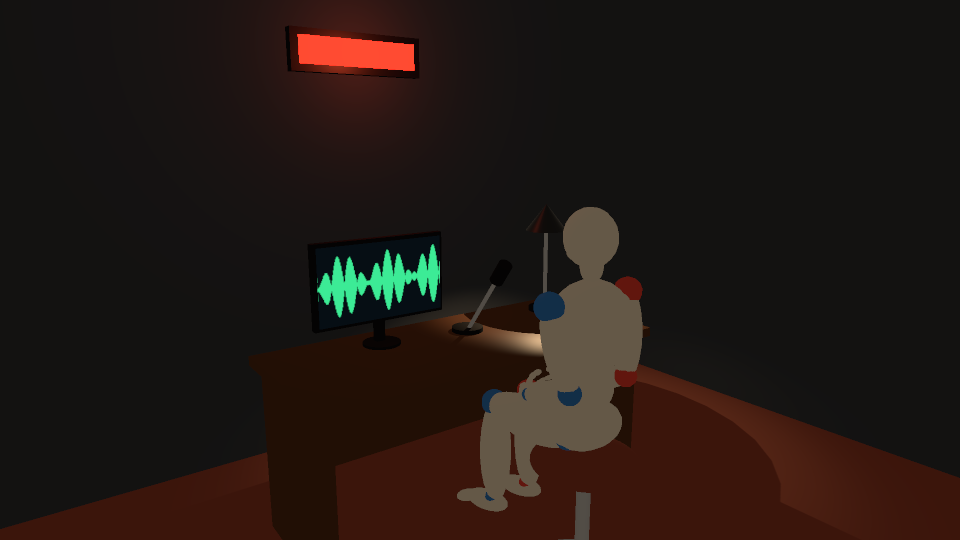
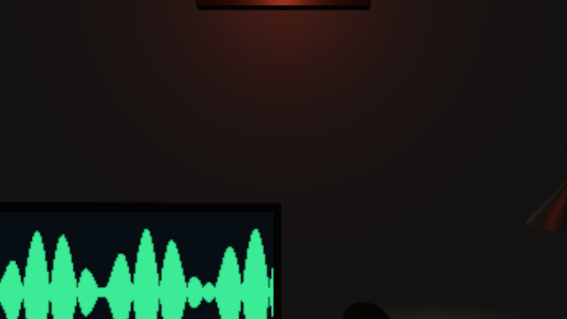
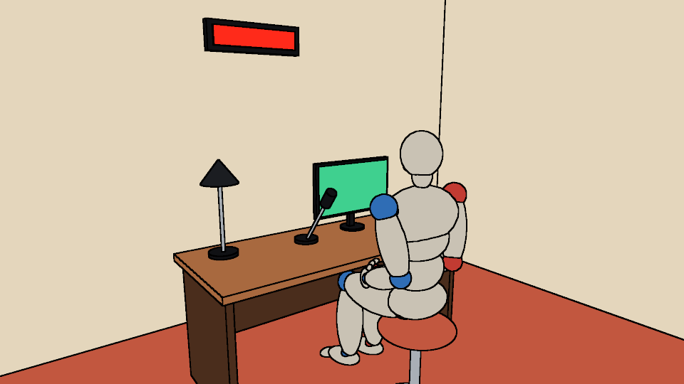

# Tutorial: create a location, then extend the SDK

This tutorial builds one small place from nothing, a radio booth, and then turns it into something other people can use. Part 1
is about the location: materials, prefabs, curved parts, lights, a screen and a body to check it with. Part 2 is about the
SDK: a plugin, a light rig, a generator, a rule, a look, paint and a published catalog.



Read the [README](../README.md) first if you have not installed anything yet. You need `./doctor.py` to have run, and
nothing else.

Every Python block below runs, in order, as one script, and `tests/test_tutorial.py` runs them, so paste them into one file as
you go. Run it from the repository root with `.venv/bin/python booth.py`. The pictures land in `renders/`.

## Part 1: Create a location

### 1. Start with a room and a camera

Begin with the stock room, one light and one shot, and draw the wireframe. It is quick, and it shows whether the camera is in
the right place before anything else exists.

```python
from srlocations import Location, Registry, Renderer
from srlocations.stock.prefabs import Room

booth = Location("booth", Registry.default())
booth.add(Room(4, 3.4, 2.6))
booth.rig("stock.interior")
booth.shot("door", (-1.5, 1.6, -1.4), (0.2, 1.0, 0.9), lens=24)
print(booth.validate() or "no issues")

renderer = Renderer()
renderer.render(booth, "door", "renders/booth-empty.png")
```

The world is in metres, with x right, y up and z away. A room's origin is the middle of its floor, so this one runs from -2
to 2 along x and from -1.7 to 1.7 along z. `validate()` returns a list of issues. An `error` means the location cannot work
and a `warning` means something looks wrong, such as a camera inside a wall.

### 2. Name your materials

A material is a set of values for a physical surface: colour, roughness, metallic, and a glow. Anything else the engine's
`<material>` takes goes in `extra`, and texture files go in `maps`. `Material.validate()` checks a material against the
engine's schema, so a misspelled attribute fails at once and not at render time.

Names go in the registry with a prefix of your own. The stock ones start with `stock.`, and `.names()` lists them.

```python
from srlocations import Material

MATERIALS = {
    "booth.foam": Material("#30343a", 0.95),
    "booth.felt": Material("#7c3a2c", 0.9, extra={"sheenColor": "#d9937e", "sheenRoughness": 0.5}),
    "booth.walnut": Material("#4a2d1c", 0.45),
    "booth.steel": Material("#a9afb6", 0.35, 1.0),
    "booth.black": Material("#101114", 0.5),
    "booth.shade": Material("#1b1d21", 0.4, 0.6, extra={"doubleSided": True}),
    "booth.red": Material("#200000", 1.0, glow="#ff2a1a", glow_strength=3.0),
}
for name, material in MATERIALS.items():
    material.validate()
    booth.registry.materials.add(name, material)
```

The registry refuses a name twice unless you pass `override=True`, which catches two plugins that picked the same one.

### 3. Your first prefab

A `Prefab` is a reusable, parametric piece of a set. Subclass it as a dataclass, and return its nodes from `build()`. The rule
is that the origin is on the floor at the prefab's centre, because that is what makes `at=(x, 0, z)` stand it on the floor. A
`Box` has its origin at its middle, so a part sits at half its own height.

```python
from dataclasses import dataclass

from srlocations import Box, Prefab


@dataclass
class Desk(Prefab):
    width: float = 1.6
    depth: float = 0.7
    height: float = 0.74
    top: str = "booth.walnut"

    def build(self):
        w, d, h = self.width, self.depth, self.height
        parts = [Box((w, 0.04, d), at=(0, h - 0.02, 0), material=self.top, role="desk"),
                 Box((w - 0.1, 0.5, 0.02), at=(0, h - 0.3, d / 2 - 0.06), material=self.top, name="modesty")]
        for side in (-1, 1):
            parts.append(Box((0.04, h - 0.04, d - 0.1), at=(side * (w / 2 - 0.05), (h - 0.04) / 2, 0), material=self.top))
        return parts


booth.nodes.clear()
booth.add(Room(4, 3.4, 2.6, walls="booth.foam", floor="booth.felt"))
booth.rig("stock.interior")
booth.add(Desk(at=(0, 0, 0.75)))
renderer.render(booth, "door", "renders/booth-desk.png", "stock.shaded", width=640, height=360)
```

A prefab can be any size of tree. `name=` gives a part a path such as `desk/modesty`, which a look or a test can aim at, and
`role=` says what a part is, and every part under it inherits that. `booth.nodes.clear()` is only here because this script
keeps growing one location. `location.add()` returns the node, so you can keep it.

Use the shape that fits: `Box`, `Cylinder`, `Cone`, `Sphere`, `Backdrop` (a flat picture), `Surface` (below) and `Mesh` (a model
file). Solids with `casts_shadow=False` cost less, and suit small parts that a lamp sits right beside.

### 4. Turn parts with a Group

A `Group` moves and turns its children together, about its own origin. So build a part standing upright from its pivot, then
turn the group. That is much easier than working out where the far end lands.

```python
from srlocations import Cylinder, Group, Sphere


@dataclass
class Microphone(Prefab):
    reach: float = 0.34
    lean: float = 38

    def build(self):
        arm = Group([Cylinder(0.009, self.reach, at=(0, self.reach / 2, 0), material="booth.steel"),
                     Cylinder(0.03, 0.1, at=(0, self.reach + 0.05, 0), material="booth.black", name="head")],
                    pitch=self.lean, name="arm")
        return [Cylinder(0.07, 0.02, at=(0, 0.01, 0), material="booth.black", name="foot"), arm]
```

Turns are the mistake everyone makes first, so learn these three:

| Turn | Means | Effect on a part standing up |
| --- | --- | --- |
| `yaw=90` | +z turns toward +x | a part facing -z now faces -x |
| `pitch=30` | +z turns toward +y | its top leans back, toward -z |
| `pitch=-30` | | its top leans forward, toward +z |

The microphone stands on the desk's far side and has to lean toward the person at -z, so it needs a positive `pitch`. A seat
back that leans away from the person sitting in it is a part with the wrong sign, and it looks fine until you see it from the
side. Always check a turned part from the side.

### 5. Curved parts, and somewhere to sit

A `Surface` draws anything you can write as `x(u, v)`, `y(u, v)` and `z(u, v)`, in metres, with angles in degrees. Here `u`
goes round and `v` goes from the bottom to the top, which makes a squashed sphere: a cushion. `closed=(True, False)` joins the
ends of `u`, so no seam shows.

A prefab says where a figure can sit by overriding `seats()`. A `Seat` holds the floor under the hips, the way the figure
faces, the height of the seat above that floor, and how far ahead the front edge is. Those are all in the prefab's own frame.

```python
from srlocations import Seat, Surface, Vec3


@dataclass
class Stool(Prefab):
    """Faces -z, as a stock chair does, so a seat at yaw 180 faces +z."""
    height: float = 0.5
    radius: float = 0.19
    cushion: str = "booth.felt"

    def seats(self):
        return [Seat(Vec3(0, 0, 0), 180.0, self.height + 0.03, 0.1)]

    def build(self):
        r, h = self.radius, self.height
        pad = Surface(f"{r} * cos(u) * cos(v)", f"0.05 * sin(v)", f"{r} * sin(u) * cos(v)", u=(0, 360), v=(-90, 90),
                      closed=(True, False), at=(0, h, 0), material=self.cushion, name="pad")
        return [Cylinder(0.24, 0.03, at=(0, 0.015, 0), material="booth.steel"),
                Cylinder(0.025, h - 0.03, at=(0, h / 2, 0), material="booth.steel"), pad]
```

`inward=True` on a `Surface` makes it face the other way, for a shell seen from inside, and a mirrored expression needs it
too. If a curved part vanishes from one side, that is the first thing to try. The other cure is `doubleSided` on the material.

### 6. Things that give light

Three different things make a set look lit, and they are not the same thing.

**A light.** `Point`, `Spot`, `Sun`, `Ambient` and `Sky` are nodes, so a lamp prefab carries the light it gives, and the light
goes where the lamp goes. A `Spot` points along its +z, so `pitch=-90` aims it straight down. `reach` is where it fades out,
and keeping it short keeps a light out of the rest of the frame.

**A glow.** A material with `glow` looks bright and lights nothing around it. A lit sign needs both, as the one below has.

**A screen.** A `Backdrop` is a flat picture that faces -z, and it has no back. An `emissiveMap` shows a picture as light of its
own, and it needs a black base colour. A roughness near 0.75 keeps the room's lamps from leaving a shine across it.

Any PNG will do for the picture. This one is made here so that the tutorial has no files to download.

```python
import math
import struct
import zlib
from pathlib import Path

from srlocations import Backdrop, Cone, Point, Spot


def png(path, width, height, pixel):
    """A PNG from pixel(x, y) -> (red, green, blue, alpha). Returns its full path, which a material's map needs."""
    rows = b"".join(b"\0" + bytes(value for x in range(width) for value in pixel(x, y)) for y in range(height))

    def chunk(kind, data):
        return struct.pack(">I", len(data)) + kind + data + struct.pack(">I", zlib.crc32(kind + data))

    head = struct.pack(">IIBBBBB", width, height, 8, 6, 0, 0, 0)
    Path(path).parent.mkdir(parents=True, exist_ok=True)
    Path(path).write_bytes(b"\x89PNG\r\n\x1a\n" + chunk(b"IHDR", head) + chunk(b"IDAT", zlib.compress(rows)) + chunk(b"IEND", b""))
    return str(Path(path).resolve())


def wave(x, y):
    height = 34 * abs(math.sin(x / 19) * math.sin(x / 5)) + 2
    return (60, 235, 150, 255) if abs(y - 45) < height else (6, 14, 20, 255)


MATERIALS["booth.screen"] = Material("#000000", 0.75, glow="#ffffff", maps={"emissiveMap": png("renders/wave.png", 160, 90, wave)})
booth.registry.materials.add("booth.screen", MATERIALS["booth.screen"])


@dataclass
class Monitor(Prefab):
    width: float = 0.56
    height: float = 0.32

    def build(self):
        w, h = self.width, self.height
        return [Cylinder(0.08, 0.012, at=(0, 0.006, 0), material="booth.black"),
                Box((0.04, 0.12, 0.03), at=(0, 0.07, 0.02), material="booth.black"),
                Box((w + 0.03, h + 0.03, 0.03), at=(0, h / 2 + 0.12, 0), material="booth.black"),
                Backdrop(w, h, at=(0, h / 2 + 0.12, -0.025), material="booth.screen", name="screen")]


@dataclass
class Lamp(Prefab):
    power: float = 2.4

    def build(self):
        return [Cylinder(0.08, 0.02, at=(0, 0.01, 0), material="booth.black"),
                Cylinder(0.01, 0.42, at=(0, 0.22, 0), material="booth.steel"),
                Cone(0.1, 0.13, at=(0, 0.47, 0), material="booth.shade", casts_shadow=False),
                Spot(self.power, at=(0, 0.42, 0), pitch=-90, cone=120, reach=2.2, color="#ffd9a8", shadows=True, name="bulb")]


@dataclass
class Sign(Prefab):
    body: str = "booth.black"
    lamp: str = "booth.red"

    def build(self):
        return [Box((0.7, 0.2, 0.05), material=self.body, role="sign"),
                Box((0.62, 0.13, 0.02), at=(0, 0, -0.03), material=self.lamp, casts_shadow=False, role="sign"),
                Point(0.5, at=(0, 0, -0.3), color="#ff5533", reach=1.8, name="wash")]


booth.nodes.clear()
booth.add(Room(4, 3.4, 2.6, walls="booth.foam", floor="booth.felt"))
booth.rig("stock.interior", fill=0.22)
booth.add(Desk(at=(0, 0, 0.75)))
booth.add(Microphone(at=(0.1, 0.74, 0.86)))
booth.add(Monitor(at=(-0.3, 0.74, 0.92)))
booth.add(Lamp(at=(0.62, 0.74, 0.92)))
booth.add(Stool(at=(0, 0, 0.02), yaw=180))
booth.add(Sign(at=(0, 2.0, 1.67)))
renderer.render(booth, "door", "renders/booth-lit.png", "stock.shaded", width=640, height=360)
```

### 7. Check it with a body

A set can look right and be wrong: a desk too low to sit at, a door a person would not fit through. Put a body in it. A mark
is a named place, and `location.stand()` puts a mannequin on it. A figure in the `sit` pose takes the nearest free seat within
0.8 m of the mark.

```python
booth.mark("host", (0, 0, -0.45), facing=0)
host = booth.stand("host", pose="sit", kind="woman")[0]
booth.pov(host, "host-eyes")
print(booth.clashes(bodies_only=True) or "nobody passes through anything")
print([issue.message for issue in booth.validate()] or "no issues")

renderer.render(booth, "door", "renders/booth-shaded.png", "stock.shaded", width=960, height=540)
renderer.render(booth, "host-eyes", "renders/booth-eyes.png", "stock.shaded", width=640, height=360)
```

The second picture is what the host sees. Here the screen sits low and to the left, and the microphone is right under
the chin, which no check would have said. A taller monitor stand and a mic further over are the fixes.



`clashes()` lists what passes through what, and a render refuses a figure that still does. If a figure cannot fit, `stand()`
raises `CollisionError` and names what stopped it. A clash check finds overlap only, so a figure floating 15 cm above a seat
passes it, and `validate()` warns `figure-not-resting` instead. `location.gap(figure, "hips", (0, -1, 0))` measures the gap,
and `location.faults(figure)` names each limb that passes through something, as `examples/fit_check.py` does for the car. `adjust` turns
single joints on top of a pose, and `solid=False` lets a figure pass through things on purpose.

A mark also needs about 2 m of clear space above it, or `validate()` gives a `mark-blocked` warning. That is right for a
standing figure, and it makes a false alarm in a place too low to stand. Leave marks out of a set like that and place figures
by `at=`.

## Part 2: Extend the SDK

### 8. Collect it in a plugin

So far everything has been in one script. A `Plugin` packages it, so that any project gets `booth.desk` by name. It only needs
a name, a version and a `register()` that adds things to a registry. `requires` names plugins that have to load first.

```python
from srlocations import Plugin


class BoothPlugin(Plugin):
    name = "booth"
    version = "1.0.0"
    requires = ("stock",)

    def register(self, registry):
        for name, material in MATERIALS.items():
            registry.materials.add(name, material)
        for name, prefab in (("desk", Desk), ("microphone", Microphone), ("stool", Stool), ("monitor", Monitor),
                             ("lamp", Lamp), ("sign", Sign)):
            registry.prefabs.add(f"booth.{name}", prefab)
        registry.rigs.add("booth.late-night", LateNight)
        registry.archetypes.add("booth.small", SmallBooth)
        registry.checks.append(BoothHasASign())
```

The last three lines name classes that the next three steps write. Python only looks them up when `register()` runs, which
is after those steps.

In a real project this is its own file, and it loads one of three ways:

| How | Use it when |
| --- | --- |
| `registry.plugins.load_file("plugins/booth.py")` | it is one file in your project; `examples/plugins/scifi.py` is one |
| `registry.plugins.load_module("acme.booth")` | it is a module on your path |
| an entry point in `pyproject.toml` | it is an installed package; `Registry.default()` finds it by itself |

```toml
[project.entry-points."srlocations.plugins"]
booth = "acme.booth:BoothPlugin"
```

### 9. A light rig

A `LightRig` is a lighting setup that works on any location. It returns lights, and `background` is what shows where nothing
is drawn. Parameters come in as a dataclass's fields, and `location.rig(name, fill=0.1)` passes them.

```python
from srlocations import Ambient, LightRig


@dataclass
class LateNight(LightRig):
    fill: float = 0.2
    background = "#050608"

    def lights(self):
        return [Ambient(self.fill, color="#8f9fd0", name="night-fill")]
```

### 10. A generator

An `Archetype` builds a whole location. The rule is that the same seed and parameters always give the same location, so take
every random choice from a `random.Random(seed)` and never from the module's own generator. Tests and catalogs depend on that.

```python
import random

from srlocations import Archetype


class SmallBooth(Archetype):
    def build(self, registry, seed=0, width=4.0, **_):
        rolled = random.Random(seed)
        side = rolled.choice((-1, 1))
        location = Location("booth", registry)
        location.add("stock.room", width=width, depth=3.4, height=2.6, walls="booth.foam", floor="booth.felt")
        location.rig("booth.late-night")
        location.add("booth.desk", at=(0, 0, 0.75), width=rolled.uniform(1.4, 1.8))
        location.add("booth.microphone", at=(0.1 * side, 0.74, 0.86))
        location.add("booth.monitor", at=(-0.3 * side, 0.74, 0.92))
        location.add("booth.lamp", at=(0.6 * side, 0.74, 0.92))
        location.add("booth.stool", at=(0, 0, 0.02), yaw=180)
        location.add("booth.sign", at=(0, 2.0, 1.67))
        location.mark("host", (0, 0, -0.45))
        location.shot("door", (-1.5, 1.6, -1.4), (0.2, 1.0, 0.9), lens=24)
        return location
```

### 11. A rule of your own

A `Check` is a rule that `validate()` applies to every location using that registry. `solids()` gives every solid as a `Placed`
leaf, with its world transform, its `path` and its `roles`. A check runs on locations that have nothing to do with your plugin,
so it has to stay quiet on those. This one only speaks when there is a desk.

```python
from srlocations import Check, Issue


class BoothHasASign(Check):
    def run(self, location):
        roles = {role for leaf in location.solids() for role in leaf.roles}
        if "desk" in roles and "sign" not in roles:
            yield Issue("warning", "booth-no-sign", "a booth needs an on-air sign")


registry = Registry.default()
registry.plugins.load(BoothPlugin())
small = registry.archetypes.get("booth.small")().build(registry, seed=3)
small.stand("host", pose="sit", kind="man")
print(small.validate() or "no issues")
```

### 12. A look, and a pass

A `Look` changes how a location is drawn, and the location stays as it was. It is a list of passes drawn in one document, and it
can swap textures and materials as well. Keys are material names or their beginnings, `"role:wall"` or `"path:room/north/*"`.
`register()` makes it a render mode, by name.

```python
from srlocations import Flat, Ink, Look

sketch = Look([Flat(palette={"role:wall": "#e4d6bc", "role:desk": "#a8693f", "booth.felt": "#c2573f",
                    "booth.screen": "#3fd08f"}), Ink(width=2)],
              name="booth.sketch")
sketch.register(registry)
renderer.render(small, "door", "renders/booth-sketch.png", "booth.sketch", width=960, height=540)
```



When no combination of `Lit`, `Flat`, `Cel` and `Ink` gives what you want, write a `Pass`. The engine has no custom surface
shaders, but a group's blend mode and 2D effects apply to the 3D inside it. So a pass draws the whole set again, in a group,
and blends it over what came before. `stage.solids` is the set, `stage.material()` declares a material, and
`stage.compiler.draw()` is the one place a solid becomes something the engine draws.

```python
from srlocations import Lit, Pass


@dataclass
class Tint(Pass):
    color: str = "#ffc48a"

    def add(self, stage):
        group = stage.group("tint", blend="multiply")
        material = stage.material("tint-colour", baseColor=self.color, unlit=True)
        for index, leaf in enumerate(stage.solids):
            stage.compiler.draw(group, leaf, index, "tint-", material, shadow=False)


registry.passes.add("booth.tint", Tint)
warm = Look([Lit(), Tint()], name="booth.warm")
warm.register(registry)
renderer.render(small, "door", "renders/booth-warm.png", "booth.warm", width=640, height=360)
```

Adding it to `registry.passes` lets `Look.spec()` and `Look.save()` write it as data. A catalog will not take this look,
though, because a published look may only use `stock.` passes: a catalog holds data, and this is code.

A pass can also override `relight()` to change a light. Lights are shared by a whole document, so that changes them for
every pass, which is what `Cel` does to get hard shadows.

A new `RenderMode` is smaller still: a class with a `compiler()` method, added to `registry.modes`. `Shaded` in
`srlocations/compiler.py` is six lines. A new `Compiler` turns a location into something else altogether, and it should be the
last thing you reach for, since `Look` and `Pass` cover most of what people want.

### 13. Paint and characters

Paint is 2D on top of the render, and it is positioned through the camera. A `PaintItem` draws one mark. It gets a `canvas`,
whose `view.pixel()` turns a world point into a pixel of this shot, and a `node_id` to name what it draws.

```python
from srlocations import Cutout, PaintItem, Performer
from srlocations.paint import curve


class Callout(PaintItem):
    def __init__(self, point, length=70):
        self.point, self.length = Vec3.of(point), length

    def draw(self, canvas, node_id):
        x, y = canvas.view.pixel(self.point)
        canvas.shape(node_id, curve([(x, y), (x + self.length, y - self.length)], smooth=False), stroke="#ffe14d", strokeWidth=3)
```

A `Performer` is a character as a transparent picture, in whatever poses it knows. `location.cast()` stands it on a mark, with
the lowest opaque edge of the picture on the mark, and the set hides it through its depth. `Portrait` covers one fixed PNG. A
plugin that can draw characters adds them to `registry.cast`, and `SrstudioCast` in `srlocations/srstudio.py` is a full one.

```python
class Guest(Performer):
    """A plain shape, standing in for a character from an art tool."""

    def cutout(self, pose):
        def figure(x, y):
            inside = (x - 32) ** 2 + (y - 26) ** 2 < 300 or (y > 44 and abs(x - 32) < 18)
            return (60, 150, 200, 255 if inside else 0)
        return Cutout(Path(png(f"renders/guest-{pose.get('mood', 'calm')}.png", 64, 170, figure)), (14, 8, 50, 170))


small.mark("guest", (1.35, 0, 0.2), facing=-30)
small.cast(Guest(), "guest", height=1.65, pose={"mood": "calm"}, depth=False)
small.paint("notes").add(Callout((0, 0.76, 0.75)))
renderer.render(small, "door", "renders/booth-paint.png", "stock.shaded", width=640, height=360)
```

### 14. Extending with no code

Three of the extension points are data, which a person, a tool or a model can write with no Python, and which travels better
for that reason. They read the same from a JSON file (`Library.from_file`, `PropTemplate.from_file`, `Blueprint.load`).

A `Library` is materials and assemblies of existing prefabs, and `examples/cafe-lib.json` is a real one. A `Blueprint` is a whole
location. `examples/cafe.location.json` uses that library.

```python
from srlocations import Blueprint, Library

registry.use(Library("cosy", materials={"rug": Material("#6d4a7a", 0.95)}, assemblies={
    "pair": [{"use": "booth.stool", "at": [-0.3, 0, 0], "cushion": "cosy.rug"}, {"use": "booth.stool", "at": [0.3, 0, 0]}]}))

lobby = Blueprint({
    "name": "lobby",
    "nodes": [{"use": "stock.room", "width": 3, "depth": 3, "height": 2.4, "walls": "booth.foam"},
              {"use": "cosy.pair", "at": [0, 0, 0.5]}],
    "rig": {"use": "booth.late-night", "fill": 0.6},
    "shots": [{"name": "wide", "eye": [0, 1.4, -1.3], "look_at": [0, 0.5, 0.5], "lens": 28}],
}).build(registry)
print(lobby.validate() or "no issues")
```

A `PropTemplate` is a parametric prop in data, with limits on its parameters and expressions in place of numbers. It is the
data form of a `Prefab`, and a catalog can hold it, parameters and all. `examples/props/` has three. `publish_template()` builds it
at its defaults, its limits and every variant first, so a template that cannot make a prop is refused there and not on
someone else's machine.

```python
from srlocations import PropTemplate

riser = PropTemplate.from_data({
    "name": "riser",
    "description": "A low stage; its height is a parameter",
    "params": {"width": {"default": 1.6, "min": 0.8, "max": 4}, "height": {"default": 0.15, "min": 0.05, "max": 0.6}},
    "slots": {"top": "booth.walnut"},
    "parts": [{"solid": "box", "size": ["width", "height", 1.2], "at": [0, "height / 2", 0], "shader": "top"}],
})
```

### 15. Publish it

A plugin only works where it is installed. A `SharedCatalog` freezes props into plain data, so anyone can use them with no
code at all. Materials go first as shaders, and then a prefab is built with those names, and `slots` says which of them a user
may swap.

```python
from dataclasses import replace

from srlocations import SharedCatalog

studio = SharedCatalog.create("shared", "studio")
registry.use(studio)
for name, material in MATERIALS.items():
    studio.publish_shader(name.removeprefix("booth."), material, tags=["booth"])

desk = Desk(top="studio.walnut")
studio.publish_prop("desk", desk, registry, description="A broadcast desk", slots={"top": "studio.walnut"})
studio.publish_prop("sign", registry.create("booth.sign", body="studio.black", lamp="studio.red"), registry,
                    description="An on-air sign with its own light")
studio.publish_template(replace(riser, slots={"top": "studio.walnut"}), registry)
print(sorted(entry.name for entry in studio.entries("shader") if entry.name.startswith("from.")) or "every shader is named")

studio.publish_location("booth", {
    "name": "booth",
    "nodes": [{"use": "stock.room", "width": 4, "depth": 3.4, "height": 2.6, "walls": "studio.foam", "floor": "studio.felt"},
              {"use": "studio.desk", "at": [0, 0, 0.75]},
              {"use": "studio.riser", "at": [0, 0, -0.45], "height": 0.08},
              {"use": "studio.sign", "at": [0, 2.0, 1.67]}],
    "rig": {"use": "stock.interior", "fill": 0.9},
    "shots": [{"name": "door", "eye": [-1.5, 1.6, -1.4], "look_at": [0.2, 1.0, 0.9], "lens": 24}],
}, description="An empty radio booth")
print(studio.verify() or "clean")
```

Reading it back needs no plugin, which is the point. This is a fresh registry that has never heard of `Desk`:

```python
published = SharedCatalog.open("shared").location("booth")
print(published.validate() or "no issues")
renderer.render(published, "door", "renders/booth-published.png", "stock.shaded", width=640, height=360)
```

Some things are different once a prop is frozen, and it is better to know them before you publish:

- **Published versions never change.** Publishing the same name and version with other content raises `CatalogError` and tells
  you to bump the version, and old versions stay readable. Republishing identical content is fine, so a publish script is safe
  to rerun.
- **A location is built with nothing but stock and the catalog.** A blueprint that names a plugin's rig or prefab is refused when
  you publish it, so use `stock.interior` or carry the light in a prop.
- **A prop can carry point and spot lights, not a sun or ambient light.** Put those in the location's rig.
- **A frozen prop keeps its seats only from this version on.** `seats()` is code, so publishing writes down where they are, and
  a figure in the `sit` pose finds them on a frozen stool. A version published before has none, and published versions are not
  edited: publish a new one, or place the figure by `at=` with `solid=False`.
- **A published location cannot hold paint, looks or a cast**, because those can name files. Add them after reading it.
- **Material names matter.** A prop's material outside the catalog is copied in as `from.<name>`. It works, but it gives a user
  nothing tidy to ask for, so publish shaders first.

`SRLOCATIONS_CATALOGS` opens catalogs by itself, and the README's Sharing work section covers sealing and serving one.
`examples/publish_catalog.py` publishes everything in `catalog/`, and `examples/plugins/airliner.py` and
`examples/plugins/flight_deck.py` are full plugins written this way, each with its shaders and slots in one place.

### 16. Test what you made

Test the rule behind a thing, not the thing's numbers. A generator should repeat itself, and a location should have no errors
and no body inside anything:

```python
def test_a_seed_repeats():
    build = registry.archetypes.get("booth.small")()
    assert build.build(registry, seed=5).shots == build.build(registry, seed=5).shots
    widths = {build.build(registry, seed=seed).nodes[2].width for seed in range(6)}
    assert len(widths) > 1


def test_the_booth_is_sound():
    location = registry.archetypes.get("booth.small")().build(registry)
    location.stand("host", pose="sit")
    assert not [issue for issue in location.validate() if issue.severity == "error"]
    assert not location.clashes(bodies_only=True)


def test_the_check_speaks_up():
    location = Location("bare", registry)
    location.add("booth.desk")
    assert any(issue.code == "booth-no-sign" for issue in location.validate())
```

What only exists in pixels has to be tested in pixels: occlusion, registration and tiling. `tests/test_looks.py` renders small
frames and reads them through ffmpeg, and its helpers `stage`, `pixel` and `near` are worth copying. Then render an example and
look at it, because a render can pass every test and still look wrong.

## Recreating a place from a photograph

The car, the airliner cabin and the flight deck in `catalog/` were all built from one reference picture, and the same order
worked each time.

1. **Find the real sizes first.** A seat, a door, a row spacing or a person gives you a scale for everything else. Write them as
   constants at the top of the plugin, as `examples/plugins/airliner.py` does.
2. **Block it in boxes**, and match the camera before any detail. There is no lens shift, so a photo with converging or
   corrected verticals needs a matching eye height, not a fix afterwards. A wide lens makes a near part large, so if something
   looks wrong the camera may be too close and the part may be fine.
3. **Render the wireframe beside the photo**, then shaded, at every step. Compare one thing at a time.
4. **Add a mannequin early.** It finds a wrong height or a seat turned the wrong way sooner than anything else does.
5. **Draw instruments and signs as pictures.** `examples/flight_deck_pictures.py` draws every screen with plain Python.
6. **Light last**, and use the traced mode (`"stock.traced"`, or `Traced`) when a surface has to reflect what is around it.
7. **Publish it, then open it with no plugin** and render it again. Add a test like `test_the_published_flight_deck_needs_no_plugin`
   in `tests/test_surfaces.py`.

## When the picture is wrong

| What you see | What it usually is |
| --- | --- |
| A part leans the wrong way | The sign of `pitch`: positive leans an upright part back, toward -z |
| A wall shows the far side, or a face has gone | Winding. Use `inward=True` on a `Surface`, or `doubleSided` on the material. A mirrored part reverses it |
| A screen is blank | You are behind it: a `Backdrop` faces -z. Turn it with `yaw=180`, or for a floor or ceiling use `pitch=-90` to face up and `pitch=90` to face down |
| Speckles or stripes on a flat part | Two faces almost in one plane fight for depth. Leave 5 mm or more between them |
| A screen has a white shine | Its roughness is too low. Keep it near 0.75 with a black base colour |
| A sign glows but the wall by it is dark | Glow lights nothing, so add a `Point` |
| Lights drop out in a set with very many | The engine holds 63 lights to a screen tile. Give lights a shorter `reach` and fewer lights will share a tile |
| A figure floats above a seat, with no report | `clashes()` finds overlap, not contact. Check a side view, and the `Seat` height |
| A render raises `CollisionError` | A body is inside something. `settle()` moves it clear, and `solid=False` lets it through |
| `mark-blocked` on a set you know is fine | A mark needs about 2 m of clear space above it, so leave marks out of a low set |
| `CatalogError` about another version | Published versions are immutable, so bump the version |
| A plugin imports the wrong module | An example script and a plugin with one name shadow each other on `sys.path`, as `examples/flight_deck.py` does `plugins/flight_deck.py` |

## Which extension point

| You want | Use | Example |
| --- | --- | --- |
| A reusable piece of a set | `Prefab` | `srlocations/stock/prefabs.py` |
| That, as data with parameters | `PropTemplate` | `examples/props/` |
| Materials and assemblies as data | `Library` | `examples/cafe-lib.json` |
| A lighting setup | `LightRig` | `srlocations/stock/rigs.py` |
| A generated location | `Archetype` | `srlocations/stock/archetypes.py` |
| A rule for `validate()` | `Check` | `srlocations/stock/checks.py` |
| Everything together | `Plugin` | `examples/plugins/scifi.py` |
| A new way of drawing, from the passes there are | `Look` | `srlocations/stock/looks.py` |
| A new drawing of the set | `Pass` | `srlocations/looks.py` |
| A size or a preset of a way to render | `RenderMode` | `srlocations/compiler.py` |
| A new target altogether | `Compiler` | `WireframeCompiler` in `srlocations/compiler.py` |
| A 2D mark | `PaintItem` | `srlocations/paint.py` |
| A drawn character | `Performer` | `srlocations/srstudio.py` |

New behaviour belongs in one of these, and not in a branch in a compiler. `CLAUDE.md` describes how the pieces fit together
inside.
